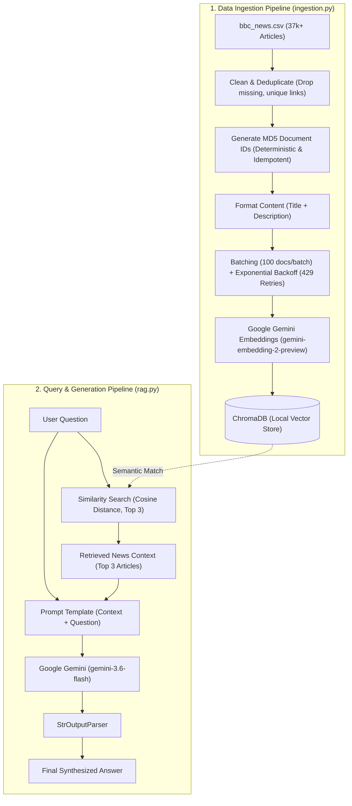

# BBC News RAG

> **Semantic News Retrieval & Grounded Question-Answering with Google Gemini, LangChain, and ChromaDB**

---

## 1. Problem Statement (In Simple Words)

Imagine having a spreadsheet containing **37,000+ BBC news articles**:
* **Why not simple search (`Ctrl + F`)?** Keyword search only matches exact words. Searching for *"international conflicts"* completely misses articles discussing *"war in Ukraine"* or *"tensions in Europe"*.
* **Why not send all articles to ChatGPT or Gemini?** You cannot pass 37,000 articles in one prompt. It blows past token limits, costs too much, and takes too long.
* **Why not ask Gemini without the articles?** Standard AI models don't have access to your local dataset and will guess or make up facts (hallucinations).

### The Solution:
This application implements **RAG (Retrieval-Augmented Generation)**:
1. When you ask a question, it searches your local news database for the top 3 most relevant articles based on **meaning (semantics)**, not just keywords.
2. It passes those 3 articles to Google Gemini as context.
3. Gemini writes a direct, accurate answer based strictly on the factual news retrieved.

---

## 2. Architecture & Flow Diagram

The diagram below illustrates both the **Data Ingestion** and **Query & Generation** pipelines:



---

## 3. How It Works (The 4-Step Pipeline)

### Step 1: Cleaning & Deduplication (`ingestion.py`)
- Reads raw articles from `bbc_news.csv`.
- Drops rows with missing fields and removes duplicate links.
- Assigns a deterministic **MD5 hash** of each article link as the document ID so re-running ingestion is idempotent (no duplicates).
- Combines `Title` and `Description` into a single semantic text chunk.

### Step 2: Vector Embeddings & Storage (`chroma_db/`)
- Uses **`gemini-embedding-2-preview`** to convert article texts into numerical vectors representing their semantic meaning.
- Saves vectors and metadata (`title`, `published_date`, `link`, `tags`) into a persistent local **ChromaDB** database.
- Implements **batching (100 docs/batch)** and **exponential backoff retry logic** to gracefully handle Google API rate limits (HTTP 429).

### Step 3: Semantic Retrieval (`rag.py`)
- When a user submits a query, `NewsSearchService` searches ChromaDB using cosine similarity.
- Finds the top $k$ (default 3) most relevant articles even if they use completely different wording.

### Step 4: Grounded Answer Synthesis (`rag.py` & `app.py`)
- Chains the retriever, a custom prompt template, and **`gemini-3.6-flash`** using LangChain LCEL.
- Instructs Gemini to answer concisely using **only** the retrieved context, eliminating AI hallucinations and citing sources.

---

## 4. Project Structure

```
fetch_news/
├── app.py              # Main application: performs search & RAG question answering
├── config.py           # Centralized configuration (models, delays, batch sizes)
├── ingestion.py        # Ingestion pipeline: cleans, embeds, & indexes news
├── rag.py              # LangChain RAG pipeline (retriever + Gemini LCEL chain)
├── bbc_news.csv        # Raw BBC news dataset (~37k articles)
├── chroma_db/          # Persistent local Chroma vector database
├── pyproject.toml      # Project metadata, lean dependencies, and CLI entry points
├── Dockerfile          # Optimized multi-stage Docker build (~720 MB)
├── docker-compose.yml  # Docker Compose orchestration for ingestion & QA
└── .dockerignore       # Prevents local caches, venvs, and secrets from entering Docker
```

---

## 5. How to Run the Application (Local Setup)

### Step 1: Environment Setup & Installation
Ensure you have Python 3.12+ installed. Clone or navigate to the repository, create a virtual environment, and install dependencies using `pyproject.toml`:

```bash
# 1. Create and activate a virtual environment
python -m venv virtual
source virtual/bin/activate

# 2. Install the package and dependencies in editable mode
pip install -e .
```

### Step 2: Configure API Key
Create a `.env` file in the project root:
```env
GOOGLE_API_KEY="your-google-gemini-api-key"
```

---

### Step 3: Execution Commands

Installing the project with `pip install -e .` registers native terminal commands inside your virtual environment:

| Task | Using Console Command (Fastest) | Using Standard Python |
| :--- | :--- | :--- |
| **Run QA Application** | `bbc-rag` | `python app.py` |
| **Run Data Ingestion** | `bbc-ingest` | `python ingestion.py` |

> [!NOTE]
> Make sure your virtual environment is active (`source virtual/bin/activate`). Run `bbc-rag` and `bbc-ingest` directly as terminal commands without putting `python` in front.

---

## 6. Docker & Docker Compose Guide

The image uses an optimized multi-stage build that strips debug symbols and bytecode caches, achieving a lean image size of **~720 MB**.

### Option A: Using Docker Compose (Recommended)

#### 1. Ingest Data (First-Time Setup)
Runs the `ingest` service to index articles into the shared named volume `chroma_data`:
```bash
docker compose run --rm ingest
```

#### 2. Query the System (RAG QA)
To run queries directly against the stored vectors:
```bash
docker compose run --rm --no-deps app
```
*(Using `--no-deps` tells Docker Compose to run the `app` immediately without waiting for `ingest` to re-execute).*

---

### Option B: Using Standard Docker CLI

#### 1. Build the Image
```bash
docker build -t bbc-news-rag:v1 .
```

#### 2. Run Ingestion Inside Docker
```bash
docker run --rm -it \
  --env-file .env \
  -v "$(pwd)/chroma_db:/app/chroma_db" \
  bbc-news-rag:v1 bbc-ingest
```

#### 3. Run the QA App
```bash
docker run --rm -it \
  --env-file .env \
  -v "$(pwd)/chroma_db:/app/chroma_db" \
  bbc-news-rag:v1
```
*(Mounting `$(pwd)/chroma_db` ensures articles indexed locally or in previous runs are reused immediately without re-embedding).*
